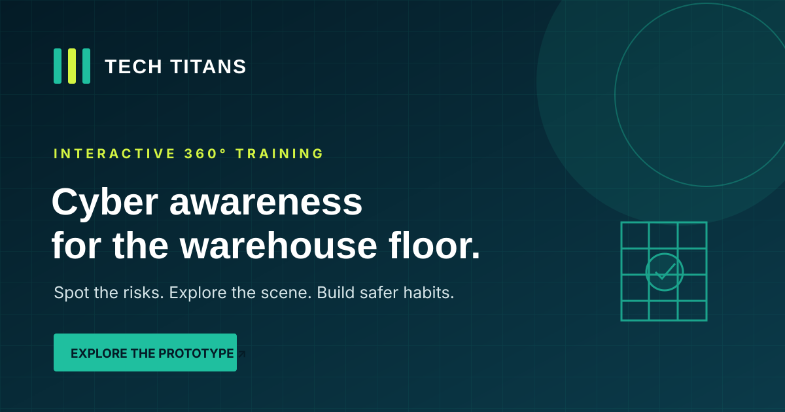

# Tech Titans — Cyber Awareness 360°

A lightweight project website introducing the Tech Titans team and its **Cyber Awareness 360°** cybersecurity-awareness prototype.

## Project links

- **Team website:** [Open the live website](https://pyatrick666.github.io/techtitans-site/index.html)
- **Cyber Awareness 360° prototype:** [Open the live prototype](https://abiralpokhrel-learns.github.io/cyberawareprototype/)
- **Related source repository:** [360-VR-](https://github.com/pyatrick666/360-VR-)

## Visual preview



## Overview

The site introduces the purpose of the Cyber Awareness 360° project, presents the team and its roles, and directs visitors to the interactive prototype. It was created as the public-facing companion site for the CET257 Enterprise Project.

## Pages

| File | Purpose |
| --- | --- |
| `index.html` | Project introduction, mission, and services section |
| `demo.html` | Prototype information and demo access |
| `about.html` | Team information, project mission, and visual identity |
| `contact.html` | Contact information and email-app-based contact form |

## Features

- Simple navigation between pages
- Project mission and team introduction
- Team member roles
- Links to the Cyber Awareness 360° prototype
- Contact form that opens the visitor's default email application
- Responsive static front-end implementation

## Technology stack

- **HTML5** — structure and content
- **CSS3** — layout and visual styling
- **JavaScript** — client-side interactions

## Run locally

No package installation or build step is required.

```bash
git clone https://github.com/pyatrick666/techtitans-site.git
cd techtitans-site
```

Open `index.html` in a browser, or use a local development server such as VS Code Live Server.

## Team

| Team member | Role |
| --- | --- |
| Dipendra Thapa | Project Manager |
| Pratik Poudel | Developer |
| Younash Sherchan | Analyst |
| Abiral Pokhrel | Documentation |

## Academic context

Developed as part of the **CET257 Enterprise Project** at ISMT College, associated with the University of Sunderland.

## Author

**Pratik Poudel** · [GitHub](https://github.com/pyatrick666)
