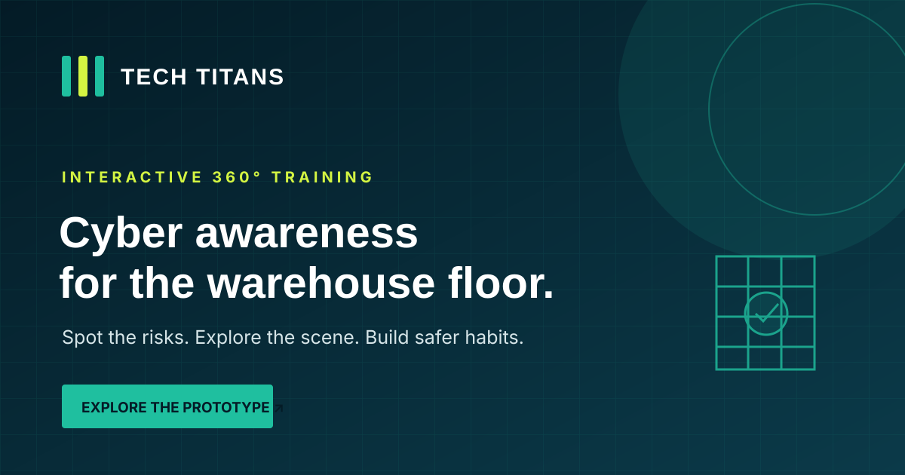

# Tech Titans — Cyber Awareness 360°

A promotional website for the Tech Titans enterprise project, introducing the team, its mission, and the Cyber Awareness 360° cybersecurity awareness prototype.

## Project Links

- **Website:** [Open the live website](https://pyatrick666.github.io/techtitans-site/index.html)
- **Cyber Awareness 360° prototype:** [Open the live prototype](https://abiralpokhrel-learns.github.io/cyberawareprototype/)

## Visual Preview



## Overview

The Tech Titans website presents the team and its Cyber Awareness 360° project. It introduces the project’s purpose, shares team information, and directs visitors to the interactive prototype designed to support cybersecurity awareness.

## Pages

| File | Purpose |
|---|---|
| `index.html` | Home page introducing the team, project mission, and services section |
| `demo.html` | Prototype page with the embedded demo, demo login information, and an overview of the prototype |
| `about.html` | Team information, project mission, and visual identity |
| `contact.html` | Contact information and an email form that opens the visitor’s email application |

## Features

- Clear navigation between the main pages
- Introduction to the project and its mission
- Team information and role descriptions
- Link to the Cyber Awareness 360° prototype
- Contact option using the visitor’s default email application
- Lightweight static website built with HTML, CSS, and JavaScript

## Technology Stack

- **HTML5** — page structure and content
- **CSS3** — layout and styling
- **JavaScript** — interactive behaviour

## Run Locally

No package installation is required for this static website.

1. Clone the repository:

   ```bash
   git clone https://github.com/pyatrick666/techtitans-site.git
   cd techtitans-site
   ```

2. Open `index.html` in your browser. Alternatively, use your editor’s Live Server extension for a local preview.

## Team

| Team member | Role |
|---|---|
| Dipendra Thapa | Project Manager |
| Pratik Poudel | Programmer |
| Younash Sherchan | Analyst |
| Abiral Pokhrel | Documentation |

## Academic Context

Developed as part of the CET257 Enterprise Project at ISMT College, associated with the University of Sunderland.
